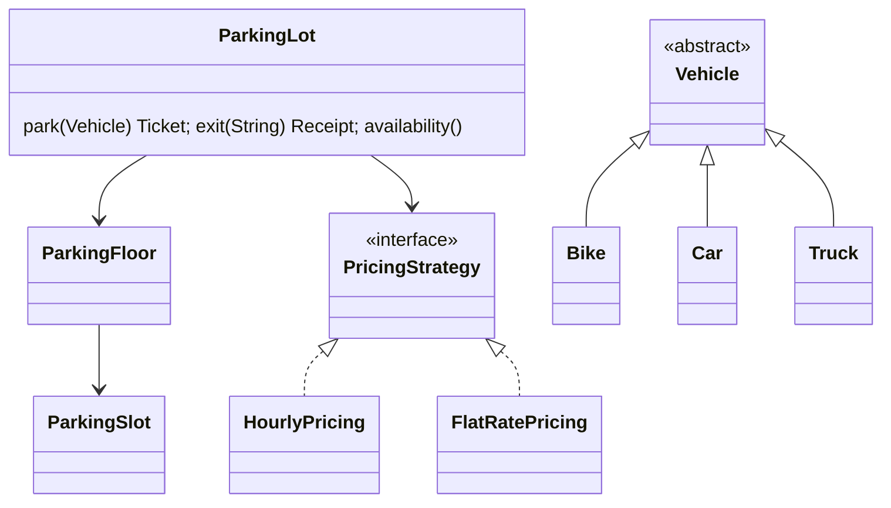

# Parking System (Java)

A multi-floor parking lot simulator that demonstrates object-oriented design, design patterns and unit testing.

## Features
- Bikes, cars and trucks mapped to small, medium and large slots (best-fit allocation)
- Multiple floors, ticket issue on entry and fee calculation on exit
- Swappable pricing rules (hourly or flat rate)
- Custom exceptions for a full lot, invalid tickets and duplicate vehicles
- Thread-safe: a concurrency test checks that 50 simultaneous cars never overbook 10 slots
- Console menu to try it out

## Design
| Concept | Where |
|---|---|
| Strategy pattern | `PricingStrategy` with `HourlyPricing` and `FlatRatePricing` |
| Factory pattern | `VehicleFactory` |
| Inheritance and polymorphism | `Vehicle` with `Bike`, `Car`, `Truck` |
| Encapsulation | `ParkingSlot` state can only be changed inside the package, through `ParkingLot` |
| Dependency injection | `Clock` and `PricingStrategy` passed to `ParkingLot`, so tests control time |



## Run
Requires Java 17+ and Maven.
```bash
mvn test                                   # run the unit tests
mvn package
java -jar target/parking-system-1.0.jar    # console app
```

## Ideas to extend
- Persist tickets in a database
- Add an electric-vehicle slot type with charging fees
- Add a REST API with Spring Boot
